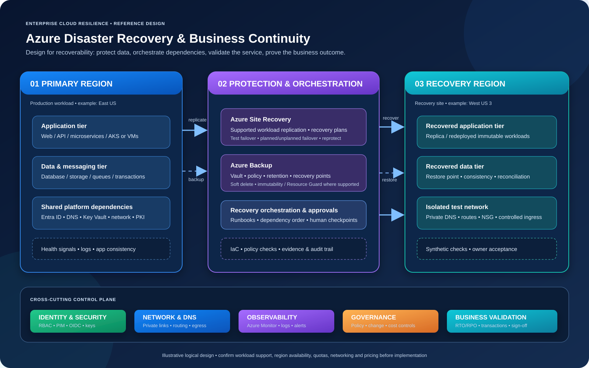

# Enterprise Azure BCDR reference architecture

**Open the [full-size premium diagram](azure-bcdr-premium.svg).** It is a vector SVG, so it remains sharp when zoomed. The Mermaid source is also available in [bcdr-reference-architecture.mmd](bcdr-reference-architecture.mmd).

## How to read the architecture

### 1. Primary region — where the business normally runs
The application tier calls the data/messaging tier and shared platform services. Identity, DNS, Key Vault, certificates and network connectivity are dependencies, not optional decorations. If any of these fail, an otherwise healthy VM may still be unusable.

### 2. Protection and orchestration — how recovery is prepared
- **Azure Site Recovery:** replication and recovery-plan orchestration for supported workload/source/target combinations.
- **Azure Backup:** workload-specific backup policies, vaults, retention and recovery points.
- **Recovery orchestration:** orders recovery steps, inserts manual approval checkpoints and captures evidence.
- **IaC and policy:** reproducible supporting infrastructure, code review and guardrails.

ASR and Azure Backup solve different protection problems. A backup is not the same thing as a replicated workload, and neither proves the full application can recover.

### 3. Recovery region — where service is brought back
The target needs compute, data, identity, routes, DNS, private endpoints, secrets and sufficient quota/capacity. Test failover should use an isolated test network. Before customer traffic is enabled, validate data consistency and an end-to-end synthetic transaction.

### 4. Cross-cutting controls
- **Identity/security:** RBAC, PIM/JIT, OIDC, Key Vault and emergency access.
- **Network/DNS:** private connectivity, routing, egress, name resolution and controlled ingress.
- **Observability:** Azure Monitor, Log Analytics, alerts and timestamped evidence.
- **Governance:** change approvals, policy, cost controls and separation of duties.
- **Business validation:** measured RTO/RPO, successful transactions and service-owner sign-off.

## Example recovery sequence

1. Confirm incident authority and business impact.
2. Validate recovery point and accepted data-loss exposure.
3. Recover shared identity/network/DNS prerequisites.
4. Recover data and messaging services.
5. Recover APIs and application workloads.
6. Validate security, dependencies, transactions and data consistency.
7. Obtain business acceptance and control traffic cutover.
8. Reprotect/failback only through a separately approved procedure.

## Design caveats

This is a logical reference, not a promise that all depicted services are available for every workload or region. Validate the exact Azure service support matrix, region/SKU availability, quotas, network topology, licensing and pricing. The sample architecture does not execute failover or deploy ASR/Backup resources.
